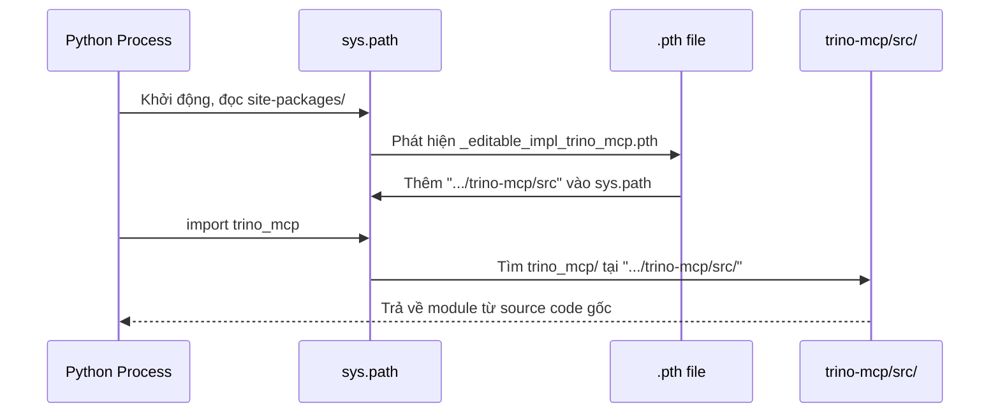

# Hướng dẫn cài đặt Trino MCP Server từ mã nguồn (Editable Mode)

## Tổng quan

Cài đặt `trino-mcp` MCP server từ source code cục bộ ở chế độ **editable**, phục vụ việc nhúng SQL AST Parser vào luồng giao tiếp LLM ↔ Database trong kiến trúc Secure Agentic BI.

---

## Bước 1 — Clone Repository

```bash
cd /Users/nguyenthanh/Master/NewGenerationSoftwareEngineering/pro/pro/secure_agentic_BI

git clone https://github.com/weijie-tan3/trino-mcp.git
```

✅ **Đã thực thi** — Repo được clone vào `trino-mcp/` trong workspace.

### Cấu trúc source code

```
trino-mcp/
├── src/
│   └── trino_mcp/
│       ├── __init__.py
│       ├── __main__.py
│       ├── server.py      ← File chính bạn sẽ sửa để nhúng SQL AST Parser
│       ├── client.py
│       ├── config.py
│       └── utils.py
├── pyproject.toml          ← Build config (hatchling + hatch-vcs)
├── uv.lock
└── ...
```

---

## Bước 2 — Tạo môi trường Python ảo chuyên biệt

> [!IMPORTANT]
> Project yêu cầu `python >= 3.10`. Python hệ thống trên macOS là 3.9.6, nên cần dùng Python 3.13 đã cài qua Homebrew.

```bash
# Tạo venv bằng Python 3.13 (Homebrew)
/opt/homebrew/opt/python@3.13/bin/python3.13 -m venv trino-mcp/.venv
```

✅ **Đã thực thi** — Virtual environment tạo tại `trino-mcp/.venv/` với Python 3.13.9.

### Kích hoạt venv (khi làm việc thủ công trong terminal)

```bash
source trino-mcp/.venv/bin/activate
```

---

## Bước 3 — Cài đặt Editable Mode

```bash
# Từ workspace root (không cần activate venv)
trino-mcp/.venv/bin/pip install -e trino-mcp/

# Hoặc nếu đã activate venv:
# cd trino-mcp && pip install -e .
```

✅ **Đã thực thi** — Kết quả:

| Thông tin | Giá trị |
|---|---|
| Package | `trino-mcp` |
| Version | `0.2.8.dev1+g38106e523` |
| Editable project location | `.../secure_agentic_BI/trino-mcp` |
| Import path trỏ về | `.../trino-mcp/src/trino_mcp/__init__.py` |
| Dependencies cài kèm | `mcp 1.30.0`, `trino 0.340.0`, `sqlglot 30.22.0`, `pydantic 2.14.0`, ... |

### Xác minh

```bash
# Kiểm tra package info
trino-mcp/.venv/bin/pip show trino-mcp

# Kiểm tra import trỏ đúng về source code
trino-mcp/.venv/bin/python -c "import trino_mcp; print(trino_mcp.__file__)"
# → .../trino-mcp/src/trino_mcp/__init__.py  ← trỏ về source, KHÔNG phải site-packages
```

---

## Bước 4 — Giải thích nguyên lý Editable Mode (`pip install -e`)

### Vấn đề mà Editable Mode giải quyết

Khi cài đặt thông thường (`pip install .`), pip **sao chép** toàn bộ source code vào `site-packages/`. Mỗi lần sửa code → phải cài lại. Điều này rất bất tiện khi phát triển.

### Cơ chế hoạt động

Editable mode **không copy** source code. Thay vào đó, nó tạo một **path redirect** trong `site-packages/`:

```
site-packages/
├── _editable_impl_trino_mcp.pth    ← File .pth chứa đường dẫn tuyệt đối
└── trino_mcp-0.2.8.dev1+g38106e523.dist-info/
    ├── METADATA
    └── ...
```

Nội dung file `.pth`:
```
/Users/nguyenthanh/.../secure_agentic_BI/trino-mcp/src
```

### Chuỗi sự kiện khi Python import



### Tóm tắt so sánh

| | `pip install .` | `pip install -e .` |
|---|---|---|
| **Source code** | Copy vào `site-packages/` | Giữ nguyên tại vị trí gốc |
| **Sửa code** | Phải `pip install .` lại | Thay đổi có hiệu lực ngay lập tức* |
| **Cơ chế** | File `.py` trong `site-packages/` | File `.pth` trỏ về thư mục `src/` |
| **Metadata** | `.dist-info/` trong `site-packages/` | `.dist-info/` trong `site-packages/` (giống nhau) |
| **Use case** | Production, deployment | Development, debugging |

> [!NOTE]
> *"Ngay lập tức" nghĩa là: mỗi khi Python **import lại** module (ví dụ restart server), nó sẽ đọc file `.py` mới nhất từ source. Nếu module đã được import trong process đang chạy, cần restart process hoặc dùng `importlib.reload()`.

---

## Bước tiếp theo

Khi bạn sẵn sàng nhúng SQL AST Parser, file chính cần sửa là:
- [`server.py`](file:///Users/nguyenthanh/Master/NewGenerationSoftwareEngineering/pro/pro/secure_agentic_BI/trino-mcp/src/trino_mcp/server.py) — Entry point của MCP server
- [`client.py`](file:///Users/nguyenthanh/Master/NewGenerationSoftwareEngineering/pro/pro/secure_agentic_BI/trino-mcp/src/trino_mcp/client.py) — Trino client wrapper

Chạy server:
```bash
source trino-mcp/.venv/bin/activate
trino-mcp   # hoặc: python -m trino_mcp
```
