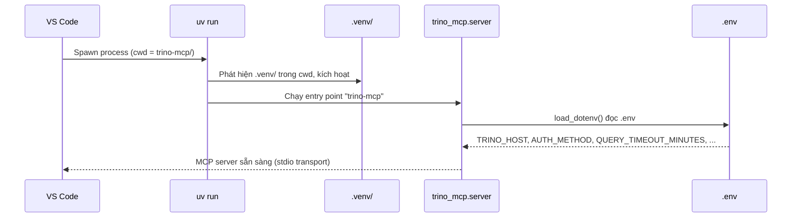
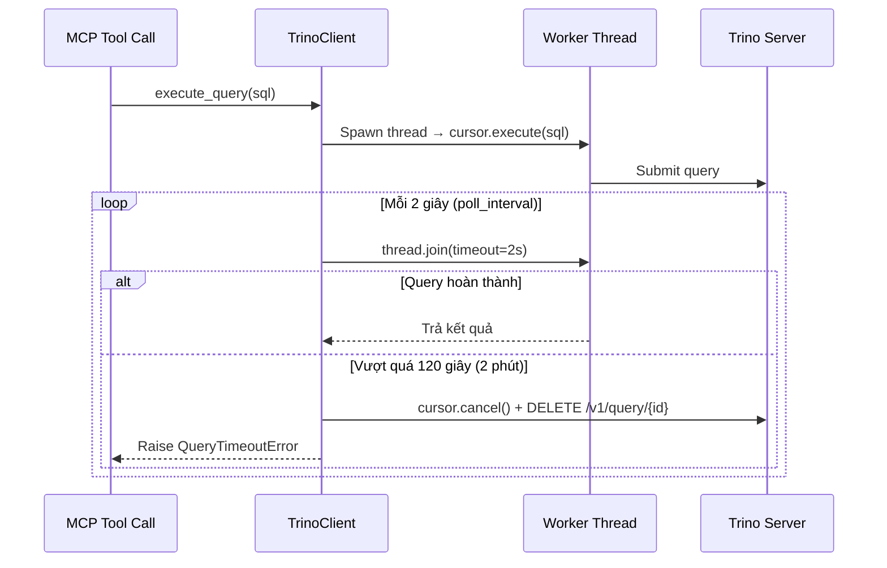

# Cấu hình Trino MCP Server — Environment & VS Code Integration

## 1. File `.env` — Kết nối & Rào chắn bảo mật

📍 Vị trí: [`trino-mcp/.env`](file:///Users/nguyenthanh/Master/NewGenerationSoftwareEngineering/pro/pro/secure_agentic_BI/trino-mcp/.env)

```env
# --- Trino Connection ---
TRINO_HOST=localhost
TRINO_PORT=8080
TRINO_USER=admin
TRINO_HTTP_SCHEME=http
AUTH_METHOD=NONE

# --- Security ---
ALLOW_WRITE_QUERIES=false

# --- DoS Defense ---
QUERY_TIMEOUT_MINUTES=2
MAX_CONCURRENT_QUERIES=1
```

### Bảng tham chiếu

| Biến | Giá trị | Tại sao chọn giá trị này |
|---|---|---|
| `AUTH_METHOD` | `NONE` | Trino dev không có password |
| `ALLOW_WRITE_QUERIES` | `false` | LLM không được phép INSERT/UPDATE/DELETE/DROP |
| `QUERY_TIMEOUT_MINUTES` | `2` | Cắt mọi query chạy quá 2 phút |
| `MAX_CONCURRENT_QUERIES` | `1` | Chỉ 1 query/lần, chặn spam |

---

## 2. File `.vscode/mcp.json` — Tích hợp MCP vào VS Code

📍 Vị trí: [`.vscode/mcp.json`](file:///Users/nguyenthanh/Master/NewGenerationSoftwareEngineering/pro/pro/secure_agentic_BI/.vscode/mcp.json) (ngang hàng với `docker-compose.yml`)

```json
{
  "servers": {
    "trino-mcp": {
      "type": "stdio",
      "command": "uv",
      "args": ["run", "trino-mcp"],
      "cwd": "${workspaceFolder}/trino-mcp"
    }
  }
}
```

### Luồng khởi động khi VS Code kích hoạt MCP server



> [!IMPORTANT]
> `"cwd": "${workspaceFolder}/trino-mcp"` là tham số mấu chốt. Nó đảm bảo:
> - `uv run` tìm thấy `pyproject.toml` và `.venv/` đúng thư mục
> - `load_dotenv()` trong `config.py` đọc file `.env` nằm cùng cấp (vì `python-dotenv` tìm `.env` từ cwd trở lên)

---

## 3. Giải thích 2 rào chắn phòng thủ DoS

### Rào chắn 1: `QUERY_TIMEOUT_MINUTES=2` — Giới hạn thời gian query

**Vấn đề:** Một LLM agent có thể sinh ra query cực nặng (ví dụ `SELECT *` trên bảng hàng tỷ dòng, hoặc cross join vô hạn). Nếu không giới hạn, query này chiếm tài nguyên Trino vô thời hạn.

**Cơ chế hoạt động** (triển khai tại [`client.py` L117–L207](file:///Users/nguyenthanh/Master/NewGenerationSoftwareEngineering/pro/pro/secure_agentic_BI/trino-mcp/src/trino_mcp/client.py#L117-L207)):



**Chi tiết kỹ thuật:**
- Client chạy query trong **worker thread** riêng biệt
- Main thread giữ **deadline** = `time.monotonic() + timeout_seconds`
- Mỗi 2 giây, kiểm tra `thread.join(timeout=2)` — nếu vượt deadline → **cancel 2 lớp**:
  1. `cursor.cancel()` — gửi tín hiệu cancel qua Trino Python client
  2. `DELETE /v1/query/{query_id}` — fallback gọi trực tiếp REST API của Trino
- LLM nhận thông báo lỗi rõ ràng: *"Query exceeded the 2-minute timeout... write a more efficient query"*

---

### Rào chắn 2: `MAX_CONCURRENT_QUERIES=1` — Giới hạn đồng thời

**Vấn đề:** Một LLM agent (hoặc nhiều agent song song) có thể "bom" server bằng cách gửi hàng chục query cùng lúc, làm quá tải Trino cluster.

**Cơ chế hoạt động** (triển khai tại [`server.py` L30, L499](file:///Users/nguyenthanh/Master/NewGenerationSoftwareEngineering/pro/pro/secure_agentic_BI/trino-mcp/src/trino_mcp/server.py#L30)):

```python
# Khởi tạo (1 lần duy nhất khi server start)
_query_semaphore = asyncio.Semaphore(1)   # ← chỉ 1 slot

# Mỗi tool call đều phải đi qua gate này
if _query_semaphore.locked():             # ← tất cả slot đã đầy?
    return "Error: All 1 concurrent query slot(s) are in use..."

async with _query_semaphore:              # ← acquire slot, tự release khi xong
    result = await asyncio.to_thread(client.execute_query, sql)
```

**Hành vi:**
- `asyncio.Semaphore(1)` = chỉ **1 query được phép chạy tại bất kỳ thời điểm nào**
- Khi slot đã bị chiếm → tool call thứ 2 **bị reject ngay lập tức** (không xếp hàng chờ, không block)
- LLM nhận thông báo: *"All 1 concurrent query slot(s) are in use. Please wait..."*

> [!NOTE]
> Điểm thiết kế đáng chú ý: Server dùng `_query_semaphore.locked()` để kiểm tra trước khi `async with` — nghĩa là **reject ngay** thay vì xếp hàng. Đây là chiến lược **fail-fast**, ngăn LLM tích lũy hàng đợi dài gây timeout dây chuyền.

---

## Tổng quan kiến trúc rào chắn

```
  LLM Agent
      │
      ▼
┌─────────────────────────────────┐
│  MCP Server (trino-mcp)        │
│                                 │
│  ┌───────────────────────────┐  │
│  │ Rào 1: Semaphore(1)      │  │  ← Chặn > 1 query đồng thời
│  │ MAX_CONCURRENT_QUERIES=1  │  │     (reject ngay, không xếp hàng)
│  └───────────┬───────────────┘  │
│              │                  │
│  ┌───────────▼───────────────┐  │
│  │ Rào 2: Watchdog Timer     │  │  ← Cắt query chạy > 2 phút
│  │ QUERY_TIMEOUT_MINUTES=2   │  │     (cancel cả client + server)
│  └───────────┬───────────────┘  │
│              │                  │
│  ┌───────────▼───────────────┐  │
│  │ Rào 3: Write Block        │  │  ← Chặn INSERT/UPDATE/DELETE/DROP
│  │ ALLOW_WRITE_QUERIES=false │  │
│  └───────────┬───────────────┘  │
│              │                  │
└──────────────┼──────────────────┘
               ▼
         Trino Server
        localhost:8080
```

Ba lớp rào chắn này tạo thành chiến lược **defense-in-depth**: ngay cả khi LLM bị prompt injection, nó không thể ghi dữ liệu, không thể spam query, và không thể giữ tài nguyên quá 2 phút.
